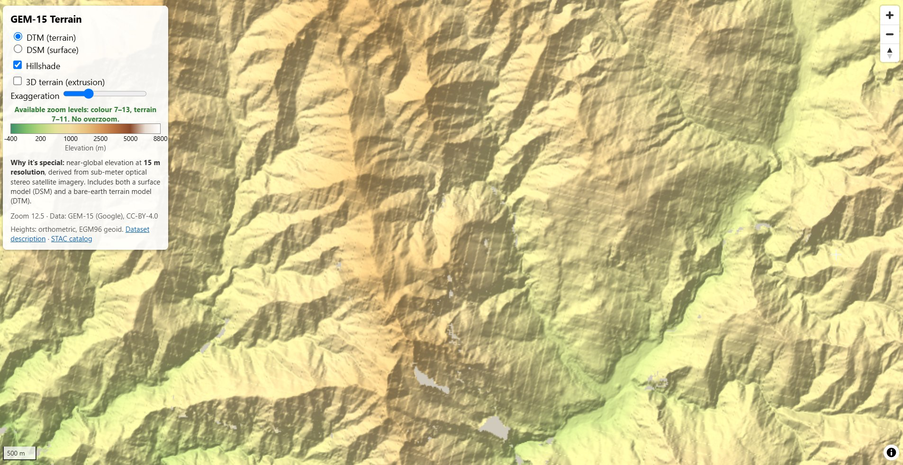

# GEM-15 Terrain Viewer

A framework-free [MapLibre GL JS](https://maplibre.org/) viewer for the
[GEM-15 (Google Elevation Models, 15 m)](https://storage.googleapis.com/climate-and-sustainability/gem-15/stac/catalog.json)
STAC catalog. DTM/DSM Cloud-Optimized GeoTIFFs are read directly in the browser,
colored with a hypsometric tint (green lowlands, yellow/orange hills, brown mountains,
white peaks) and optionally hillshaded.

## How it works

- `app.js` registers a custom MapLibre protocol (`gem://`) that renders 256 px raster tiles on demand.
- For each tile it finds the 1x1 degree STAC items (`stac/gem-15/<group>/<cell>/<cell>.json`),
  reads only the needed window/overview of the COG with HTTP range requests
  ([geotiff.js](https://geotiffjs.github.io/)), reprojects from local UTM with
  [proj4js](http://proj4js.org/), and applies the color ramp and hillshade.
- Data is only loaded from zoom level 7 and up.
- Click the map to see the elevation (full 15 m resolution) of the selected layer in a popup.
- Libraries are loaded from CDNs; there is no build step and no server component.

## CORS

The public bucket URLs (`storage.googleapis.com/<bucket>/<object>`) send no CORS headers.
The Cloud Storage JSON API media endpoint
(`https://storage.googleapis.com/storage/v1/b/<bucket>/o/<encoded-object>?alt=media`)
serves the same objects with CORS and `Range` support, so the viewer uses that and works
from any origin, including GitHub Pages.

## Run locally

Serve this folder with any static server, e.g. `python -m http.server 8000`,
then open http://localhost:8000.

## GitHub Pages

Enable GitHub Pages for the repository (branch root). The viewer only needs
`index.html`, `app.js` and `style.css`.

## Files

| File | Purpose |
| --- | --- |
| `index.html`, `style.css` | Page, layer controls and legend |
| `app.js` | Tile rendering, color ramp, hillshade, map |

## Data

GEM-15 © Google, licensed [CC-BY-4.0](https://creativecommons.org/licenses/by/4.0/).

**Vertical datum:** all elevations are *orthometric* heights (above the geoid, roughly mean sea level),
referenced to the **EGM96 geoid** ([EPSG:5773](https://epsg.io/5773)), not ellipsoidal (WGS84) heights.
Source: the [GEM-15 Earth Engine catalog entry](https://developers.google.com/earth-engine/datasets/catalog/projects_climate-and-sustainability_assets_gem-15_v1).
The elevation shown in the click popup uses this datum.

Pixels without data (NaN) show the ocean color; clicking such a pixel shows "No data".

## Known artifacts

In rugged terrain with hillshade enabled you may see faint, near-vertical stripes with a regular
spacing, a fine dotted pattern, and small grey patches (zoom 12.5 shown below).

**Likely explanation:** these come from the data, not the viewer. GEM-15 is derived from sub-meter
optical stereo satellite imagery, and such DEMs typically contain along-track strip/scan-line
artifacts, small stitching offsets between image strips, and matching noise. Hillshade amplifies
tiny elevation differences, so these become visible. The grey patches are pixels without data
(NaN), e.g. where stereo matching failed (clouds, water, shadow).

The viewer adds a minor effect: pixels are sampled nearest-neighbour (no interpolation), which makes
small stair-steps in the hillshade slightly harsher. Disabling **Hillshade** hides most of the stripes.
