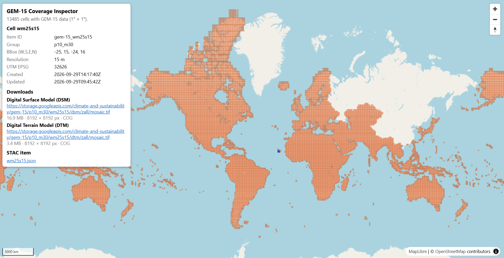
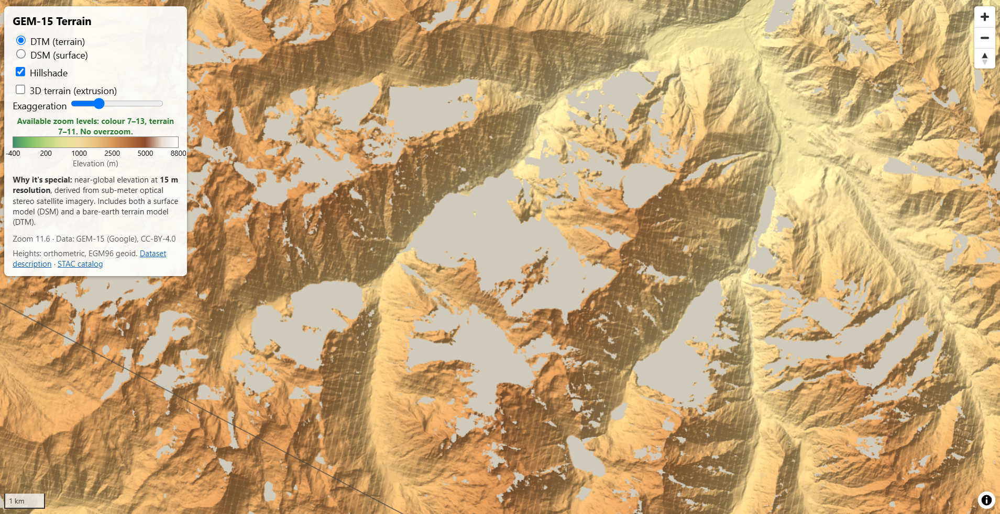

# GEM-15 Terrain Viewer

A framework-free [MapLibre GL JS](https://maplibre.org/) viewer for the
[GEM-15 (Google Elevation Models, 15 m)](https://storage.googleapis.com/climate-and-sustainability/gem-15/stac/catalog.json)
STAC catalog. DTM/DSM Cloud-Optimized GeoTIFFs are read directly in the browser,
colored with a hypsometric tint (green lowlands, yellow/orange hills, brown mountains,
white peaks) and optionally hillshaded.

## How it works

- `app.js` registers a custom MapLibre protocol (`gem://`) that renders 256 px raster tiles on demand.
- For each tile it finds the 1x1 degree STAC items (`stac/gem-15/<group>/<cell>/<cell>.json`),
  reads only the needed window/overview of the COG with HTTP range requests
  ([geotiff.js](https://geotiffjs.github.io/)), reprojects from local UTM with
  [proj4js](http://proj4js.org/), samples elevations bilinearly, and applies the color ramp and hillshade.
- Data is only loaded from zoom level 7 and up.
- Click the map to see the elevation (full 15 m resolution) of the selected layer in a popup.
- Libraries are loaded from CDNs; there is no build step and no server component.

## Coverage inspector

`inspector.html` is a standalone page (MapLibre GL JS, no frameworks, no build step) that shows
which 1° × 1° cells have GEM-15 data, at every zoom level.

- On load it lists the STAC folders in the bucket (10° groups, then the cells in each group) through the
  Cloud Storage JSON API and draws every cell as a polygon; cells without data are not drawn.
- Hover highlights a cell; labels appear from zoom 7.
- Click a cell to load its STAC item and show the details (bbox, resolution, UTM EPSG, dates) plus
  download links for the DTM and DSM Cloud-Optimized GeoTIFFs (with file size and dimensions) and the STAC item JSON.

*Screenshot taken on 2026-11-15.*

**Statistics (2026-11-15):** 13,485 cells with GEM-15 data (1° × 1° each), across 297 groups of 10° × 10°.
The count is read live from the bucket, so it may change as data is added.
COGs created: 2026-09-29T14:17:40Z.
Total size of the COGs: 11.19 TiB (≈ 12.3 TB), of which DSM 9.38 TiB (≈ 10.3 TB) and DTM 1.81 TiB (≈ 2.0 TB), 13,485 files each.

- Open it at `/inspector.html` (e.g. `https://<user>.github.io/gem15/inspector.html` on GitHub Pages).

## CORS

The public bucket URLs (`storage.googleapis.com/<bucket>/<object>`) send no CORS headers.
The Cloud Storage JSON API media endpoint
(`https://storage.googleapis.com/storage/v1/b/<bucket>/o/<encoded-object>?alt=media`)
serves the same objects with CORS and `Range` support, so the viewer uses that and works
from any origin, including GitHub Pages.

## Run locally

Serve this folder with any static server, e.g. `python -m http.server 8000`,
then open http://localhost:8000.

## GitHub Pages

Enable GitHub Pages for the repository (branch root). The viewer only needs
`index.html`, `app.js` and `style.css`.

## Files

| File | Purpose |
| --- | --- |
| `index.html`, `style.css` | Page, layer controls and legend |
| `app.js` | Tile rendering, color ramp, hillshade, map |
| `inspector.html` | Coverage map of available cells with details and download links |

## Data

GEM-15 © Google, licensed [CC-BY-4.0](https://creativecommons.org/licenses/by/4.0/).

**Vertical datum:** all elevations are *orthometric* heights (above the geoid, roughly mean sea level),
referenced to the **EGM96 geoid** ([EPSG:5773](https://epsg.io/5773)), not ellipsoidal (WGS84) heights.
Source: the [GEM-15 Earth Engine catalog entry](https://developers.google.com/earth-engine/datasets/catalog/projects_climate-and-sustainability_assets_gem-15_v1).
The elevation shown in the click popup uses this datum.

Pixels without data (NaN) show the ocean color; clicking such a pixel shows "No data".

## Known artifacts

In rugged terrain you may notice an artifact that most likely originates in the GEM-15 data itself,
not in the viewer.

### Grey patches (no data)

Large and small grey areas appear, mostly in steep high-mountain terrain (zoom 11.6 below).

**Likely explanation:** these are pixels without data (NaN), drawn grey. Stereo matching fails where
the imagery has no usable texture or correlation, for example snow and ice fields, cloud cover, deep
shadow, or water. The gaps are not filled in the source data, so the viewer shows them as-is.
Clicking such a pixel shows "No data".
